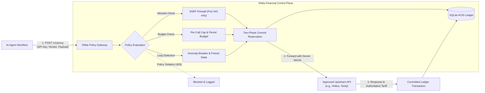

# Shlita (שְׁלִיטָה)

> **Spending policy gateway for autonomous AI agents.**<br/>
> Enforce budgets, control vendor access, and audit every spending decision before payment occurs.


[](https://github.com/XiaoArnav/Shlita/actions/runs/43374212468)
[](docs/step-11/DASHBOARD_BROWSER_VERIFICATION.md)
[](tsconfig.json)
[](https://shlita.vercel.app/?demo=1)
[](https://xiaoarnav.github.io/Shlita/?demo=1)
[](LICENSE)

---

## What is Shlita?

**Shlita** (Hebrew for *"Governance & Control"*) is a local financial policy proxy and operator control plane built for autonomous AI agents, tool-calling LLMs, and multi-agent systems.

When agents execute autonomous workflows, granting them direct access to credit cards or raw crypto wallets creates severe operational risks: recursive tool loops, prompt injection attacks, and concurrency race conditions that can drain budgets in seconds.

Shlita sits between your AI agent and upstream paid APIs (such as Solana RPCs, LLM inference endpoints, or web search services). It intercepts each outbound call, validates provider policies, reserves funds atomically in an ACID-backed SQLite ledger, injects upstream credentials server-side, and records every spending outcome for complete auditability.

### Start Here
- ⚡ **Interactive Dashboard Demo**: [shlita.vercel.app/?demo=1](https://shlita.vercel.app/?demo=1) (static UI preview with sample data)
- 🚀 **Quickstart Guide**: Jump straight to [Local Quickstart](#quickstart) or [Developer Quickstart](docs/sdk/quickstart.md)
- 📦 **Agent SDK**: [Install `shlita-sdk`](#agent-sdk-integration) to wrap agent tool calls in spending guardrails
- 📖 **API Specification**: [OpenAPI Contract (YAML)](docs/api/openapi.yaml)
- 📺 **Video Walkthrough**: [Watch the Demo on YouTube](https://youtu.be/o5vHfcUjDJE)
- 📝 **Architecture Deep Dive**: [Read on DEV.to](https://dev.to/polymath_arnav/why-we-built-a-financial-firewall-for-autonomous-ai-agents-on-solana-acid-reservations-zero-key-4mfe)

---

## How It Works



### Transaction Lifecycle States

| Lifecycle State | Meaning |
| :--- | :--- |
| `REQUEST_RECEIVED` | Request accepted by gateway; authentication validated. |
| `POLICY_REJECTED` | A rule denied the request (e.g. unapproved vendor, over budget); no upstream call is made. |
| `BUDGET_RESERVED` | Budget atomically locked in SQLite WAL ledger before upstream dispatch. |
| `VENDOR_SUCCEEDED` / `FAILED` | Provider response and billable tariff recorded server-side. |
| `ACCOUNTING_COMMITTED` | Ledger hold permanently reconciled to actual tariff cost. |
| `ACCOUNTING_ROLLED_BACK` | Reservation released back to agent budget if provider fails or times out. |
| `SETTLEMENT_PENDING` | Payment instruction prepared for Solana RPC; awaiting network confirmation. |
| `SETTLEMENT_CONFIRMED` | Real transaction signature confirmed on the configured Solana cluster. |

---

## Core Features

- 🛡️ **Per-Call & Period Spending Limits**: Enforces hard per-request ceilings (e.g., max $0.05 USDC per call) and rolling periodic budgets (daily/monthly limits) with deterministic automatic rollover.
- 🔒 **Atomic Two-Phase Reservations**: SQLite WAL-mode ledger implements concurrency-safe budget reservations (`evaluateAndReserve` ➔ `commitReservation` / `rollbackReservation`), eliminating race conditions under parallel agent bursts.
- 🌐 **Vendor Allowlisting & SSRF Firewall**: Confines agents to explicitly approved provider hostnames (e.g., `api.helius.xyz`). Strictly blocks loopback, private subnets (RFC 1918), link-local metadata (`169.254.169.254`), non-443 ports, and userinfo embeds.
- 🔁 **Financial Idempotency**: Cryptographically fingerprints requests (`idempotencyKey` + payload hash) to prevent duplicate execution or payload mutation on network retries.
- 🛑 **Operator Freeze Controls**: Operators can instantly freeze individual agents via UI or API. Freeze state persists durably in SQLite across gateway restarts.
- 📊 **Live Telemetry & Dashboard Streaming**: Operator control dashboard displays live ledger transactions, per-agent budget utilization, and real-time event telemetry that auto-refreshes without manual page reload.
- 🔑 **Server-Side Secret Injection**: Agent processes receive scoped Shlita API keys. Upstream provider secrets (Helius, Tavily) are injected by the gateway and never exposed to the agent runtime. Gemini integration is planned for a follow-up release.

---

## Verification & Engineering Baseline

Shlita’s behavior is independently audited and backed by reproducible automated tests in CI:

| Capability / Surface | Verified Status | Tested Environment & Evidence |
|---|---|---|
| **Automated Test Matrix** | ✅ **106 tests passed** (16 files) | Node 24.22.1 in Ubuntu CI & macOS ([CI Run 43374212468](https://github.com/XiaoArnav/Shlita/actions/runs/43374212468)) |
| **Dashboard Browser E2E** | ✅ **Verified in Chromium** | Playwright v1.65.0 headless browser test ([DASHBOARD_BROWSER_VERIFICATION.md](docs/step-11/DASHBOARD_BROWSER_VERIFICATION.md)) |
| **SDK External Install** | ✅ **Verified Tarball Install** | External temporary consumer project outside repository ([`sdk.consumer.test.ts`](tests/sdk.consumer.test.ts)) |
| **Docker Persistence** | ✅ **Verified WAL Persistence** | Container stop/start test preserves state on `/var/lib/shlita` volume |
| **Static UI Mirrors** | 🌐 **Static Frontend Only** | [Vercel Demo](https://shlita.vercel.app/) and [GitHub Pages](https://xiaoarnav.github.io/Shlita/) (pre-rendered UI, no live backend) |
| **Local Gateway Runtime** | 💻 **Supported Entry Point** | `npm start` serves the gateway API (`/v1`) and control dashboard from a single origin |
| **Public Gateway Deployment** | ⏳ **Tracked Under Step 12** | Container image published to GHCR; persistent public HTTPS gateway pending hosting setup |
| **Solana Settlement Logic** | ⚠️ **Unit Math Passing / Funded Blocked** | 9 unit tests pass. Funded local validator test is historically reported (PR #5) and currently blocked by missing BPF binary in git |

> Detailed findings, claim reconciliations, and readiness scorecards are documented in the [Step 11 Verification Baseline](docs/step-11/VERIFICATION_BASELINE.md).

---

## Quickstart

### Prerequisites
- **Node.js** >= 20.0.0 (Node 22 recommended)
- **npm** >= 10.0.0

### 1. Clone & Install
```bash
git clone https://github.com/XiaoArnav/Shlita.git
cd Shlita
npm install
```

### 2. Run Automated Verification
```bash
# Run unit, integration, security, and SDK tests (106 tests)
npm test

# Run Playwright Chromium end-to-end browser test
npm run test:browser

# Run terminal attack simulation & circuit breaker demonstration
npm run demo
```

### 3. Build & Launch Local Gateway
```bash
npm run build
npm start
```

Open [http://127.0.0.1:4000](http://127.0.0.1:4000) in your browser:
- In development, an operator key is generated automatically in `.shlita/` if not set.
- Add `?demo=1` to explore the dashboard with pre-loaded mock balance samples.
- To configure an explicit operator key, provide both `SHLITA_OPERATOR_KEY` and `SHLITA_OPERATOR_ORG`:
  ```bash
  SHLITA_OPERATOR_KEY="your-32-char-secret-operator-key" SHLITA_OPERATOR_ORG="org-pilot" npm start
  ```
  `SHLITA_OPERATOR_ORG` defines the organization boundary for the operator: it partitions multi-tenant agent ownership, scopes dashboard access and policy mutations strictly to that organization's agents, and tags all financial audit records.

### 4. Run via Docker Compose
A single container backed by a persistent SQLite volume is the supported production deployment model:

```bash
# Start gateway on port 4010 with persistent volume
SHLITA_OPERATOR_KEY="your-32-char-secret-operator-key" SHLITA_OPERATOR_ORG="org-pilot" docker compose up -d
```

Access the gateway at [http://127.0.0.1:4010](http://127.0.0.1:4010). SQLite database and backups are stored in the `shlita-data` volume mapped to `/var/lib/shlita`.

---

## Agent SDK Integration

The client library is located in `packages/sdk` under the package name `shlita-sdk`.

### Pack and Install
Because `shlita-sdk` is private to this repository, pack a tarball to install in external projects:

```bash
npm run build:sdk
cd packages/sdk
npm pack --pack-destination /tmp/shlita-sdk
```

In your agent's project:
```bash
npm install /tmp/shlita-sdk/shlita-sdk-0.1.0.tgz
```

### Code Example
Wrap your agent's tool dispatches through `ShlitaAgentClient`:

```typescript
import { ShlitaAgentClient } from 'shlita-sdk';

const shlita = new ShlitaAgentClient({
  baseUrl: process.env.SHLITA_GATEWAY_URL || 'http://127.0.0.1:4000',
  apiKey: process.env.SHLITA_AGENT_API_KEY!,
});

// Proxy an approved vendor request
const result = await shlita.proxy({
  agentId: 'research-agent-01',
  vendor: 'api.helius.xyz',
  method: 'POST',
  path: '/v0/token-metadata',
  body: {
    mints: ['EPjFWdd5AufqSSqeM2qN1xzybapC8G4wEGGkZwyTDt1v'],
  },
  idempotencyKey: `op-${Date.now()}-${crypto.randomUUID()}`,
});

if (result.outcome === 'committed') {
  console.log('Vendor response:', result.responseBody);
  console.log('Accounted spend (micro-USDC):', result.reservedAmountMicroUsdc);
} else {
  console.error('Request blocked by Shlita policy:', result.error);
}
```

### cURL Example
```bash
curl -X POST "http://127.0.0.1:4000/v1/proxy" \
  -H "x-shlita-api-key: $SHLITA_AGENT_API_KEY" \
  -H "Content-Type: application/json" \
  -d '{
    "agentId": "research-agent-01",
    "vendor": "api.helius.xyz",
    "method": "POST",
    "path": "/v0/token-metadata",
    "body": { "mints": ["EPjFWdd5AufqSSqeM2qN1xzybapC8G4wEGGkZwyTDt1v"] },
    "idempotencyKey": "op-test-12345",
    "simulate": true
  }'
```

---

## Repository Structure

```
shlita/
├── packages/
│   ├── core/                  # Financial ledger & ACID SQLite rules engine
│   ├── gateway/               # Hono HTTP API (/v1/proxy, /v1/agents, SSRF firewall)
│   ├── sdk/                   # Typed agent & operator SDK clients (shlita-sdk)
│   └── solana/                # Canonical Solana Subscriptions protocol integration
├── src/                       # React 18 + Vite + Tailwind v4 operator dashboard
├── demo/                      # Terminal attack simulation & circuit breaker script
├── tests/                     # 106 automated Vitest tests & Playwright browser suite
├── examples/                  # Runnable agent client & policy pattern samples
├── docs/                      # Architectural decision records & step audits
│   ├── adr/                   # ADR 0001: Single-instance SQLite architecture
│   ├── api/                   # OpenAPI 3.0 contract specification
│   ├── sdk/                   # Developer integration & onboarding quickstart
│   └── step-11/               # Independent audit, browser E2E, & baseline records
├── GLOSSARY.md                # Ubiquitous domain terminology
├── Dockerfile                 # Production Debian Bookworm Slim container
└── compose.yaml               # Docker Compose specification with persistent volume
```

### Step 11 — Independent Engineering Baseline & Evidence Reconciliation
- [Step 11 Baseline Verification Report](docs/step-11/BASELINE_VERIFICATION.md)
- [Evidence Reconciliation Register](docs/step-11/CLAIM_EVIDENCE_REGISTER.md)
- [Step 12 Prerequisites](docs/step-11/STEP_12_PREREQUISITES.md)

### Step 12 — Persistent HTTPS Staging Deployment
- [Step 12 Staging Verification Report](docs/step-12/STAGING_VERIFICATION.md)
- **Deployment Spec:** Single-instance container behind Caddy 2 TLS reverse proxy (`compose.staging.yaml`, `Caddyfile`)
- **Planned Staging Gateway URL:** `https://gateway.staging.shlita.xyz` *(planned locked staging endpoint; live public DNS/TLS pending cloud host provisioning)*
- **Persistence & SRE:** SQLite WAL persistent volume at `/var/lib/shlita`, automated nightly `VACUUM INTO` snapshots with retention pruning, off-volume backup replication, and automated image rollback (`scripts/rollback.sh`).

---

## Audit & Verification Reports

Every roadmap step produces permanent, independently auditable engineering artifacts:

| Milestone | Report Focus | Key Documents |
|---|---|---|
| **Step 12** | Persistent HTTPS Staging | [Staging Verification](docs/step-12/STAGING_VERIFICATION.md) • [Deployment Blueprint](docs/step-8/DEPLOYMENT_BLUEPRINT.md) • [Rollback Runbook](scripts/rollback.sh) |
| **Step 11** | Engineering Baseline & Browser E2E | [Verification Baseline](docs/step-11/VERIFICATION_BASELINE.md) • [Browser E2E Report](docs/step-11/DASHBOARD_BROWSER_VERIFICATION.md) • [Claim Register](docs/step-11/CLAIM_EVIDENCE_REGISTER.md) • [Solana Reconciliation](docs/step-11/SOLANA_EVIDENCE_RECONCILIATION.md) |
| **Step 10** | Security Audit & Production Gates | [Final Audit Synthesis](docs/step-10/FINAL_AUDIT.md) • [Security Verdict](docs/step-10/SECURITY_VERDICT.md) • [Master Release Gates](docs/step-10/RELEASE_GATES.md) • [Go/No-Go Decision](docs/step-10/PILOT_GO_NO_GO.md) |
| **Step 9** | Staging Verification & Pilot Testing | [Staging Verification](docs/step-9/STAGING_VERIFICATION.md) • [10-Way Concurrency](docs/step-9/FINANCIAL_TEST_RESULTS.md) • [Persistence Recovery](docs/step-9/PERSISTENCE_RECOVERY.md) |
| **Step 8** | Pilot Blueprint & Ingress Topology | [Deployment Blueprint](docs/step-8/DEPLOYMENT_BLUEPRINT.md) • [Incident Runbook](docs/step-8/INCIDENT_RESPONSE.md) • [Developer Onboarding](docs/step-8/DEVELOPER_ONBOARDING.md) |
| **Step 7** | Readiness & Threat Classifications | [Readiness Audit](docs/step-7/READINESS_AUDIT.md) • [Security Findings](docs/step-7/SECURITY_FINDINGS.md) • [Pilot Plan](docs/step-7/PILOT_PLAN.md) |

---

## Backup & Maintenance CLI

Shlita includes built-in SQLite backup and safe restore utilities:

```bash
# Safely snapshot the SQLite ledger in WAL mode
npm run backup

# Restore a snapshot to a target destination
npm run restore -- /path/to/backup.db /var/lib/shlita/ledger.db
```

---

## License

MIT © [XiaoArnav](https://github.com/XiaoArnav)
