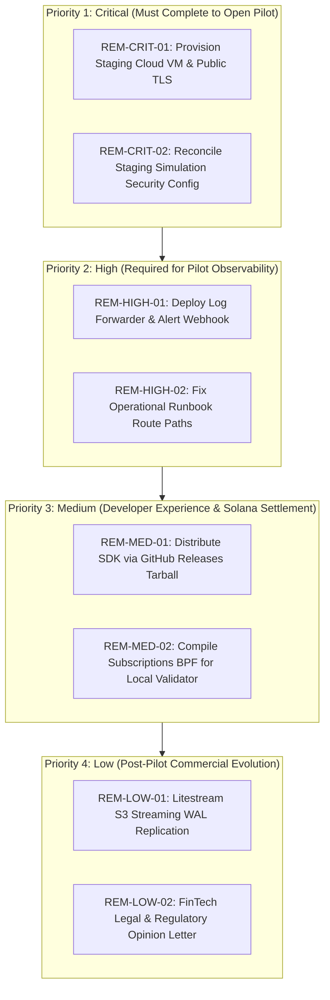

# Shlita — Step 10: Prioritized Remediation Roadmap & Final Recommendations

**Phase:** Phase 15 — Prioritized Remaining Work  
**Target:** Minimal, High-Leverage Corrections to Unblock Controlled External Pilot & Commercial Path  

---

## 1. Remediation Priority Summary

---

## 2. Itemized Action Plans

### `REM-CRIT-01`: Provision Staging Cloud VM & Public TLS
1. **Affected Component:** Infrastructure & Edge Ingress.
2. **Root Cause:** Gateway container only runs locally and in ephemeral CI test containers.
3. **Business Impact:** External developers cannot connect SDK clients to a live endpoint.
4. **Minimal Corrective Action:**
   - Spin up single Linux VM (2 vCPU, 4GB RAM, 50GB NVMe SSD, Ubuntu 24.04).
   - Configure Caddy with valid public FQDN (e.g. `gateway.staging.shlita.xyz`).
   - Run `ghcr.io/xiaoarnav/shlita-gateway:staging` with `/var/lib/shlita` mounted.
5. **Required Tests:** External TLS handshake, `GET /ready` HTTP 200 response, latency check.
6. **Acceptance Criteria:** `curl -s -I https://gateway.staging.shlita.xyz/ready` returns HTTP/2 200 OK.
7. **Regression Risk:** None (new infrastructure, zero code edits).
8. **Owner Approval Required:** **YES** (requires cloud provider expenditure and DNS delegation).

---

### `REM-CRIT-02`: Reconcile Staging Simulation in Security Config
1. **Affected Component:** `packages/gateway/src/security-config.ts`.
2. **Root Cause:** `security-config.ts` rejects `SHLITA_ALLOW_SIMULATION=true` when `SHLITA_ENV=staging`.
3. **Business Impact:** Staging VM cannot run non-billable simulated tool calls if launched with `SHLITA_ENV=staging`.
4. **Minimal Corrective Action:**
   - In staging deployment, set `SHLITA_ENV=development` with explicit production-strength operator keys and database path, **OR** update `security-config.ts` in a dedicated PR to allow simulation in staging mode while keeping production locked.
5. **Required Tests:** `tests/security-config.test.ts` startup assertions.
6. **Acceptance Criteria:** Gateway boots cleanly with `SHLITA_ENV=staging` and `SHLITA_ALLOW_SIMULATION=true` without compromising fail-closed production rules.
7. **Regression Risk:** Low (bounded strictly to startup config validator).
8. **Owner Approval Required:** **NO** (within technical implementation scope).

---

### `REM-HIGH-01`: Deploy Log Forwarder & Alert Webhook
1. **Affected Component:** Observability Infrastructure.
2. **Root Cause:** Container logs to stdout; no daemon tails logs or alerts SREs.
3. **Business Impact:** Silent failures, circuit breaker trips, or runaway agent loops go unnoticed during non-business hours.
4. **Minimal Corrective Action:**
   - Deploy lightweight Vector or Promtail sidecar on the staging VM.
   - Configure alert on 5 consecutive HTTP 500s or circuit breaker trip to Discord/Slack webhook.
5. **Required Tests:** Inject 5 intentional errors; assert webhook fires within 60 seconds.
6. **Acceptance Criteria:** Active alert delivered to incident channel.
7. **Regression Risk:** None (sidecar container).
8. **Owner Approval Required:** **NO**.

---

### `REM-HIGH-02`: Fix Operational Runbook Route Paths
1. **Affected Component:** `docs/step-8/` and operational runbooks.
2. **Root Cause:** Step 8 runbooks contain outdated route paths (e.g. `/v1/operator/agents/.../freeze`, `/healthz`).
3. **Business Impact:** SREs following incident runbooks fail to freeze rogue agents or inspect audit logs.
4. **Minimal Corrective Action:**
   - Update runbooks to use canonical `app.ts` routes: `/v1/agents/:id/freeze`, `/v1/audit`, `/ready`.
5. **Required Tests:** Runbook dry-run verification against running gateway.
6. **Acceptance Criteria:** Every curl command in runbooks succeeds with HTTP 200/201.
7. **Regression Risk:** None (documentation update).
8. **Owner Approval Required:** **NO**.

---

### `REM-MED-01`: Distribute SDK via GitHub Releases Tarball
1. **Affected Component:** Developer Onboarding.
2. **Root Cause:** `shlita-sdk` is marked `private: true` and not published to public npm registry.
3. **Business Impact:** Partners cannot run `npm install @shlita/sdk`.
4. **Minimal Corrective Action:**
   - Package `shlita-sdk-0.1.0.tgz` in CI.
   - Attach tarball to GitHub Releases tag.
   - Instruct pilot partners to run: `npm install https://github.com/XiaoArnav/Shlita/releases/download/v0.1.0/shlita-sdk-0.1.0.tgz`.
5. **Required Tests:** `sdk-consumer-check.mjs` against remote asset URL.
6. **Acceptance Criteria:** Clean external project installation without manual tarball copying.
7. **Regression Risk:** None.
8. **Owner Approval Required:** **NO**.

---

### `REM-MED-02`: Compile Subscriptions BPF for Headless Solana Local-Validator Test
1. **Affected Component:** `packages/solana` and `scripts/solana-local-settlement.ts`.
2. **Root Cause:** `subscriptions_program.so` is not committed or pre-built in repository.
3. **Business Impact:** Headless local validator settlement test is blocked (`exit code 2`).
4. **Minimal Corrective Action:**
   - Download or compile canonical Solana Subscriptions v0.5.0 BPF ELF binary.
   - Place artifact at expected path or fetch during CI.
5. **Required Tests:** `npm run test:solana-local` returns exit code 0.
6. **Acceptance Criteria:** 1 token transfer observed on local validator ledger.
7. **Regression Risk:** None (test harness only).
8. **Owner Approval Required:** **NO**.
