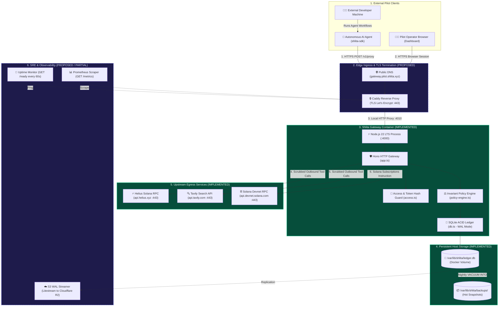

# Shlita — Staging Deployment Blueprint & Architecture

**Objective:** Minimal, resilient, single-instance staging deployment architecture for external pilot validation.  
**Operating Principle:** Deep module simplicity — zero distributed systems bloat, zero unproven microservices.  
**Target Environment:** Single Linux Virtual Machine (e.g. AWS EC2, Fly.io, or Hetzner) running Docker + Caddy TLS.

---

## 1. System Architecture Diagram



---

## 2. Infrastructure Specification

### A. Compute & Container Runtime
- **Host Spec:** 1x AMD64/ARM64 Virtual Machine (2 vCPU, 4GB RAM, 40GB NVMe SSD).
- **OS:** Ubuntu 24.04 LTS or Debian 12.
- **Container Runtime:** Docker Engine 26+ with Compose v2.
- **Base Image:** `node:22-bookworm-slim` (multi-stage build from repo `Dockerfile`, running as non-root user `shlita` with UID/GID 10001).
- **Process User:** Non-root `USER node` (UID 1000).

### B. Ingress, Domain & TLS
- **Public FQDN:** `gateway.staging.shlita.xyz` (pilot staging domain; requires cloud VM & public DNS delegation).
- **TLS Ingress:** Caddy 2 reverse proxy running as edge TLS companion service (`compose.staging.yaml`):
  ```caddy
  {$SHLITA_STAGING_DOMAIN:gateway.staging.shlita.xyz} {
      encode zstd gzip
      request_body {
          max_size 5mb
      }
      @public_probe path /health /ready /metrics
      handle @public_probe {
          reverse_proxy gateway:4000
      }
      handle {
          reverse_proxy gateway:4000 {
              header_up Host {host}
              header_up X-Real-IP {remote_host}
              header_up X-Forwarded-For {remote_host}
              header_up X-Forwarded-Proto {scheme}
          }
      }
  }
  ```
- **Port Exposure:** Only port 80 and 443 exposed publicly. Port 4000 is bound exclusively to internal bridge network / `127.0.0.1`.
- **Rollback Mechanism:** Automated image rollback script (`scripts/rollback.sh`) re-pins the container image to a specified previous SHA/tag while preserving the persistent database volume.

### C. Persistent Storage Topology
- **Single-Writer Constraint:** SQLite requires exclusive filesystem locking. Exactly **one** container instance mounts the volume.
- **Volume Mount:**
  ```yaml
  volumes:
    - shlita-data:/var/lib/shlita
  ```
- **Filesystem Options:** Ext4 or XFS with direct local attachment. Network filesystem protocols (NFS, SMB, CIFS) are **strictly prohibited** due to unreliable SQLite lock lease behavior.

### D. Environment & Secrets Provisioning
Staging `.env` strictly adheres to `packages/gateway/src/security-config.ts` validations.
Note: In locked mode (`SHLITA_ENV=staging` or `SHLITA_ENV=production`), `security-config.ts` fails closed if `SHLITA_ALLOW_SIMULATION=true`. Therefore, staging operates with `SHLITA_ALLOW_SIMULATION=false` using sandbox upstream provider keys (e.g. Helius Devnet / Tavily free tiers). If non-billable simulated tool calls without outbound network egress are specifically desired for local/CI integration testing, `SHLITA_ENV=development` is used with explicit production-strength keys and persistent storage paths (as verified in the CI persistent volume suite).

```bash
SHLITA_ENV=staging
PORT=4000
SHLITA_ALLOW_SIMULATION=false          # Locked mode: outbound proxy requires sandbox provider keys
SHLITA_SEED_DEMO=false                # No hardcoded demo agents in pilot
SHLITA_DB_PATH=/var/lib/shlita/ledger.db
SHLITA_STATE_DIR=/var/lib/shlita
SHLITA_BACKUP_DIR=/var/lib/shlita/backups
SHLITA_OPERATOR_KEY=<32-char-random-hex>
SHLITA_SESSION_SECRET=<32-char-random-hex>
SHLITA_OPERATOR_ORG=pilot-alpha
HELIUS_API_KEY=<pilot-devnet-helius-key>
TAVILY_API_KEY=<pilot-tavily-key>
SOLANA_NETWORK=devnet
SHLITA_ALLOW_MAINNET=false
```

### E. Health, Metrics & Observability
- **Health Check:** `GET /health` returns process uptime, version, and commit SHA.
- **Readiness Check:** `GET /ready` performs a live SQL query against the ledger. Returns `HTTP 503` if locked or shutting down.
- **Metrics Scraper:** `GET /metrics` exposes Prometheus format counters for active reservations, policy decisions, and burst trips.
