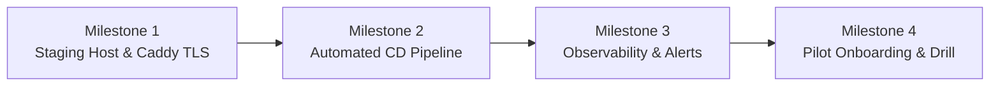

# Shlita Staging Implementation & Pilot Execution Roadmap

**Document Reference:** `docs/step-8/NEXT_IMPLEMENTATION_PLAN.md`  
**Parent Milestone:** Step 8 — Pilot Deployment Blueprint & Release-Gate Closure  
**Baseline Git Commit:** `4d461c5b1edb63db802674c4cb827a91b211627a`  
**Target Goal:** Step 9 Transition — From Architectural Blueprint to Live Staging Pilot  

---

## 1. Implementation Philosophy & Guardrails

To preserve the financial security, verified invariants, and code stability established across Steps 1–8:

1. **Zero Core Logic Churn:** No changes permitted to `packages/core`, `packages/solana`, or financial calculation modules unless resolving an empirically verified bug.
2. **Infrastructure Decoupling:** Staging infrastructure (Caddy, Docker Compose, VM definitions) must live in deployment-specific configurations outside the business logic packages.
3. **Additive-Only Configurations:** CI workflows, operator scripts, and deployment manifests must be additive without modifying existing test harness contracts.
4. **Secrets Hygiene:** All staging credentials and operator tokens must be injected at runtime via environment variables or secret stores; zero credentials committed to git.

---

## 2. 4-Stage Execution Roadmap



---

### Milestone 1: Staging Host & Ingress Infrastructure
- **Objective:** Establish the dedicated, single-tenant hosting environment specified in `docs/step-8/DEPLOYMENT_BLUEPRINT.md`.
- **Target Deliverables:**
  1. Provision Linux VM (Ubuntu 24.04 LTS, 2 vCPU, 4GB RAM, NVMe storage).
  2. Map DNS record: `staging-gateway.shlita.internal` (or public pilot domain).
  3. Deploy Caddy reverse proxy with automated Let's Encrypt TLS termination.
  4. Configure persistent host directory `/var/lib/shlita/data` with non-root ownership (`UID:GID 10001:10001`).
- **Verification Gate:**
  `curl -I https://staging-gateway.shlita.internal/healthz` returns valid SSL handshake and upstream proxy header.

---

### Milestone 2: Automated Staging Deployment Workflow
- **Objective:** Enable repeatable, audited container deployment directly from verified main branch commits.
- **Target Deliverables:**
  1. Create `.github/workflows/deploy-staging.yml` triggered via `workflow_dispatch` or push tags.
  2. Build and push production multi-stage Docker container to GitHub Container Registry (`ghcr.io/xiaoarnav/shlita-gateway:staging`).
  3. Execute automated SSH deploy script on staging host:
     ```bash
     docker compose pull gateway
     docker compose up -d gateway
     docker compose exec gateway node packages/gateway/dist/backup-cli.js
     ```
- **Verification Gate:**
  GitHub Actions run completes successfully; container reboots cleanly with WAL checkpoint intact.

---

### Milestone 3: Telemetry, Observability & Alerting Sink
- **Objective:** Close Gate 11 by establishing 24/7 monitoring and automated SRE alerting.
- **Target Deliverables:**
  1. Spin up lightweight Vector sidecar to tail container stdout JSON logs.
  2. Forward structured logs to central sink (Grafana Loki or Datadog).
  3. Configure alert rules matching `docs/step-8/INCIDENT_RESPONSE.md`:
     - Alert 1: Unhandled exceptions (`level == "error"`).
     - Alert 2: Circuit breaker state change (`status == "OPEN"`).
     - Alert 3: Consecutive 403 policy violation bursts (> 20 / min).
     - Alert 4: SQLite WAL disk space warning (> 50MB).
- **Verification Gate:**
  Synthetic error trigger delivers alert notification to Slack `#incident-shlita-pilot` within 60 seconds.

---

### Milestone 4: Smoke Test & Pilot Onboarding Drill
- **Objective:** Execute the complete end-to-end test matrix before distributing credentials to the pilot partner.
- **Target Deliverables:**
  1. Run automated test harness from `docs/step-8/PILOT_TEST_MATRIX.md` against live staging URL.
  2. Verify 18/18 test scenarios pass (Authentication, Policies, Concurrency, Upstream Timeout, Backup/Restore).
  3. Provision pilot organization `org_pilot_alpha` with $50.00 budget allocation.
  4. Generate and securely transmit credentials for `agent_prod_reader` and `agent_prod_writer`.
  5. Guide pilot partner engineering team through `docs/step-8/DEVELOPER_ONBOARDING.md`.
- **Verification Gate:**
  First governed proxy call executed by external partner agent; response header `x-shlita-reservation-id` recorded in live ledger.

---

## 3. Work Allocation & Minimal Diff Summary

| Task | Scope | Impacted Paths | Lines Changed (Est.) |
| :--- | :--- | :--- | :--- |
| **Caddy Ingress Spec** | New File | `deploy/caddy/Caddyfile` | ~40 lines |
| **Staging Compose Spec** | New File | `deploy/compose.staging.yaml` | ~60 lines |
| **Staging Deploy Workflow** | New File | `.github/workflows/deploy-staging.yml` | ~75 lines |
| **Partner Provisioning CLI**| New File | `scripts/ops/provision-agent.ts` | ~90 lines |
| **Telemetry Config** | New File | `deploy/vector/vector.yaml` | ~50 lines |
| **Core Source Code** | **NO CHANGES** | `packages/*`, `src/*`, `tests/*` | **0 lines** |

**Zero Core Footprint Guarantee:** All staging deployment files are strictly additive deployment configurations. The core financial engine, gateway routing, and Solana settlement code remain 100% untouched and protected.
