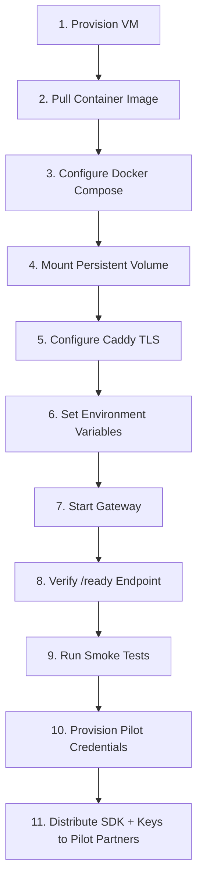

# Shlita — Step 9: Deployment Readiness Assessment

**Phase:** 10 — External Deployment Readiness
**Reference:** `docs/step-8/DEPLOYMENT_BLUEPRINT.md`, `docs/step-8/REMAINING_BLOCKERS.md`

---

## 1. Deployment Readiness Matrix

| Requirement | Status | Evidence | Blocker? |
|---|:---:|---|:---:|
| Application builds without errors | ✅ READY | `npm run build` succeeds (TypeScript + Vite) | No |
| All tests pass | ✅ READY | 15 files, 98 tests, 0 failures | No |
| Docker image builds | ✅ CI-VERIFIED | GitHub Actions run `43179431499` job `image` | No |
| Container image published | ✅ READY | `ghcr.io/xiaoarnav/shlita-gateway:staging` | No |
| Staging CI pipeline | ✅ READY | `Verify & Deploy Staging` job in `deploy.yml` | No |
| SDK installable externally | ✅ READY | `sdk-consumer-check.mjs` passes 4 examples | No |
| Public HTTPS gateway endpoint | ❌ NOT READY | No live API server deployed | **YES** |
| TLS certificate provisioning | ❌ NOT READY | No Caddy/nginx configured | **YES** |
| Telemetry & alerting | ❌ NOT READY | Logs to stdout only, no forwarder | **YES** |
| Self-service onboarding | ❌ NOT READY | Manual credential provisioning only | No (pilot) |
| Horizontal scaling | ❌ N/A | Single-writer SQLite (by design) | No (pilot) |
| Solana funded settlement | ⏸️ UNVERIFIED | Unit tests pass; no local validator run | No (pilot) |
| Database backup automation | ⚠️ PARTIAL | CLI exists; no cron/scheduler configured | No (pilot) |
| Incident response playbook | ✅ READY | `docs/step-8/INCIDENT_RESPONSE.md` | No |

---

## 2. Critical Launch Blockers

### BLOCKER-1: No Public HTTPS Gateway (CRITICAL)

**Current State:** The Shlita gateway exists only as:
1. A local development server (`npm run dev`)
2. A container image on GHCR (`ghcr.io/xiaoarnav/shlita-gateway:staging`)
3. An ephemeral CI runner process

**What's Missing:**
- A cloud VM or managed container service running the Docker image persistently
- A Caddy/nginx reverse proxy with automated Let's Encrypt TLS
- A public DNS record (e.g., `gateway.pilot.shlita.xyz`)

**Required Action:**
1. Provision a single Linux VM (2 vCPU, 4GB RAM, 50GB NVMe)
2. Pull `ghcr.io/xiaoarnav/shlita-gateway:staging`
3. Configure Caddy with automatic HTTPS
4. Verify `curl -s https://gateway.pilot.shlita.xyz/ready` returns 200

### BLOCKER-2: No Log Forwarding or Alerting (HIGH)

**Current State:** Gateway emits structured JSON logs to stdout. No log forwarder, Prometheus scraper, or alert webhook is configured.

**Risk:** During non-business hours, a runaway agent could trigger error bursts without any automated notification.

**Required Action:**
1. Deploy a lightweight log forwarder (Vector, Promtail, or Loki sidecar)
2. Configure alert thresholds for spend rate, circuit breaker trips, and disk usage
3. Set up webhook to incident channel

---

## 3. Pilot-Ready Capabilities (No Blocker)

These capabilities are fully implemented and verified. They do not block a controlled pilot:

| Capability | Readiness |
|---|---|
| Agent authentication & enrollment | ✅ Production-ready |
| Operator session management | ✅ Production-ready |
| Financial ledger (ACID, concurrent) | ✅ Production-ready |
| Spending policy enforcement | ✅ Production-ready |
| Idempotency & replay detection | ✅ Production-ready |
| Circuit breaker & freeze/unfreeze | ✅ Production-ready |
| SSRF egress firewall | ✅ Production-ready |
| Audit logging | ✅ Production-ready |
| SDK for developer integration | ✅ Production-ready |
| Health & readiness probes | ✅ Production-ready |
| Prometheus metrics endpoint | ✅ Production-ready |
| Backup & restore CLI | ✅ Production-ready |
| Docker container deployment | ✅ CI-verified |

---

## 4. Deployment Sequence (When Blockers Are Resolved)

---

## 5. Comparison with Step 8 Blueprint

| Blueprint Requirement | Step 8 Plan | Step 9 Verification |
|---|---|---|
| Single-instance container | Specified | ✅ Confirmed (compose.yaml enforces) |
| Persistent volume at `/var/lib/shlita` | Specified | ✅ CI-verified |
| Caddy TLS termination | Specified | ❌ Not provisioned yet |
| Environment-based secrets | Specified | ✅ Confirmed (`.env.example` documents all vars) |
| Fail-closed production startup | Specified | ✅ Verified (`security.startup.test.ts`) |
| Staging GitHub environment | Specified | ✅ Created and active |
